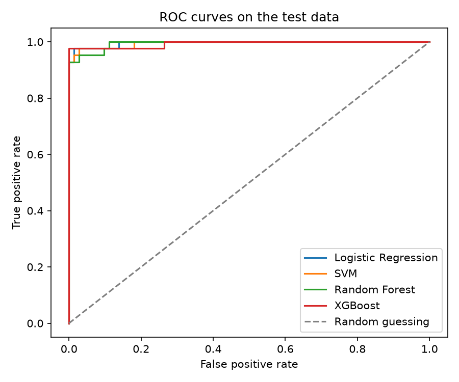
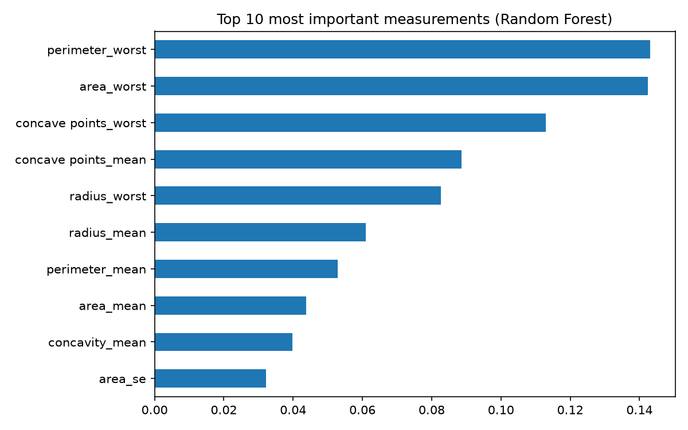

# Disease Prediction Model

This is my Task 4 project for the CodeAlpha Machine Learning internship.
The goal is to predict if a tumour is cancerous (malignant) or not
(benign) using measurements taken from a cell sample.

Important: this is a learning project. It is not a medical tool and
must not be used to diagnose anyone.

## Project video

find the likned invedio on my profile thanks

## What this project does

When a doctor finds a lump, a small sample of cells is checked and
measured. In this project I train four machine learning models on old
patient records so they can learn which measurements point to a
dangerous tumour.

I compare these four models:

- Logistic Regression
- SVM (Support Vector Machine)
- Random Forest
- XGBoost

## The data

I used the Breast Cancer Wisconsin (Diagnostic) dataset from the UCI
Machine Learning Repository. I downloaded it as a CSV file and saved it
as `data/data.csv`, and it is included in this repo.

It has 569 patients and 30 measurements for each one, such as the
size, shape and texture of the cell nuclei. Each tumour is marked as
M (malignant) or B (benign). About 37.3% of the tumours are malignant.

This data has measurements only. It does not have symptoms, age or
blood test results.

## What I did, step by step

1. **Loaded the data** from the CSV file. I removed the `id` column,
   because it is only a label and would add noise. I also removed an
   empty column at the end of the file, caused by an extra comma in the
   header.
2. **Made the label easy to read.** I changed the diagnosis so that
   1 means malignant (M) and 0 means benign (B).
3. **Split the data.** 80% for training and 20% for testing. I kept the
   same share of malignant tumours in both parts. The test data has 114
   patients: 72 benign and 42 malignant.
4. **Built the four models.** Logistic Regression and SVM work better
   with scaled numbers, so each of them has a scaler inside its own
   pipeline. Random Forest and XGBoost do not need scaling.
5. **Used 5-fold cross-validation** on the training data. The training
   data is split in 5 parts, the model learns on 4 and is checked on
   the 5th, and this repeats 5 times. It shows me how stable the recall
   is, instead of trusting one single split.
6. **Tested all four models** on the 20% test data I had kept aside.
7. **Counted the missed sick patients**, because that is the mistake
   that matters most in a disease model.

In all the scores below, "positive" means a malignant tumour.

## Results

| Model               | Accuracy | Precision | Recall | F1-Score | ROC-AUC | Missed sick patients | Cross-validated recall |
| ------------------- | -------- | --------- | ------ | -------- | ------- | -------------------- | ---------------------- |
| Logistic Regression | 0.965    | 0.975     | 0.929  | 0.951    | 0.996   | 3                    | 0.953                  |
| SVM                 | 0.974    | 1.000     | 0.929  | 0.963    | 0.995   | 3                    | 0.947                  |
| Random Forest       | 0.974    | 1.000     | 0.929  | 0.963    | 0.994   | 3                    | 0.935                  |
| XGBoost             | 0.956    | 1.000     | 0.881  | 0.937    | 0.994   | 5                    | 0.953                  |

What the scores mean in simple words:

- **Accuracy:** how many of all the patients the model got right.
- **Precision:** when the model says "malignant", how often it is right.
- **Recall:** out of all the really malignant tumours, how many the
  model found. This is the most important score here.
- **F1-Score:** one number that balances precision and recall.
- **ROC-AUC:** how well the model separates the two groups. 0.5 is
  random guessing and 1.0 is perfect.
- **Missed sick patients:** how many malignant tumours the model called
  benign in the test data.
- **Cross-validated recall:** the average recall over the 5 folds.

Output of the script:

```text
Loaded 569 patients with 30 measurements each.
Share of malignant tumours: 0.373

Logistic Regression: cross-validated recall = 0.953 (+/- 0.040)

--- Logistic Regression ---
Confusion matrix (rows = real, columns = predicted):
[[71  1]
 [ 3 39]]
Sick patients the model missed: 3

SVM: cross-validated recall = 0.947 (+/- 0.034)

--- SVM ---
Confusion matrix (rows = real, columns = predicted):
[[72  0]
 [ 3 39]]
Sick patients the model missed: 3

Random Forest: cross-validated recall = 0.935 (+/- 0.039)

--- Random Forest ---
Confusion matrix (rows = real, columns = predicted):
[[72  0]
 [ 3 39]]
Sick patients the model missed: 3

XGBoost: cross-validated recall = 0.953 (+/- 0.024)

--- XGBoost ---
Confusion matrix (rows = real, columns = predicted):
[[72  0]
 [ 5 37]]
Sick patients the model missed: 5

Top 10 measurements for the Random Forest:
perimeter_worst         0.143121
area_worst              0.142449
concave points_worst    0.112978
concave points_mean     0.088663
radius_worst            0.082649
radius_mean             0.061043
perimeter_mean          0.052928
area_mean               0.043820
concavity_mean          0.039761
area_se                 0.032237
```

### ROC curves



### Most important measurements (Random Forest)



## What I found

All four models did well. Accuracy was between 95.6% and 97.4%, and the
ROC-AUC was 0.994 or higher for every model. The test data had 42
malignant tumours. Logistic Regression, SVM and Random Forest each
missed 3 of them (recall 0.929), and XGBoost missed 5 (recall 0.881).
SVM, Random Forest and XGBoost never called a healthy patient sick
(precision 1.0), but Logistic Regression had 1 false alarm. For a
disease model I care more about missed sick patients than false alarms,
so I look at recall first.

The cross-validated recall was between 0.935 and 0.953. Logistic
Regression and XGBoost had the highest (0.953). XGBoost had a good
cross-validated recall but the lowest test recall. This shows that one
test split with only 42 sick patients can move the numbers a lot, since
one patient changes the recall by about 2.4 points. Because of this, I
cannot say that one model is clearly the best.

The most important measurements for the Random Forest were
perimeter_worst, area_worst and concave points_worst. These are the
"worst" (largest) values found in the sample, so the size and shape of
the biggest cells seem to matter most.

## Limits of this project

- The dataset is small, so scores can change with a different split.
- I tested on one hold-out set with only 42 malignant tumours, so the
  differences between the models are small and not very reliable.
- Cross-validation helped, but I did not use it for the final scores.
- I did not tune the models much. This is a first working version.
- The data comes from one source, so the models may not work as well
  on patients from other hospitals.
- It is a learning project and not a medical tool.

## How to run it

```
python3 -m venv .venv
source .venv/bin/activate
python -m pip install -r requirements.txt
python disease_prediction_model.py
```

The results table and the pictures are saved in the `results` folder.
SVM may show a harmless warning about the `probability` setting in newer
versions of scikit-learn.

## Tools used

Python, pandas, NumPy, scikit-learn, XGBoost and Matplotlib.

## What I learned
cleaning: sorting cleaning and arranging the data ready for training
